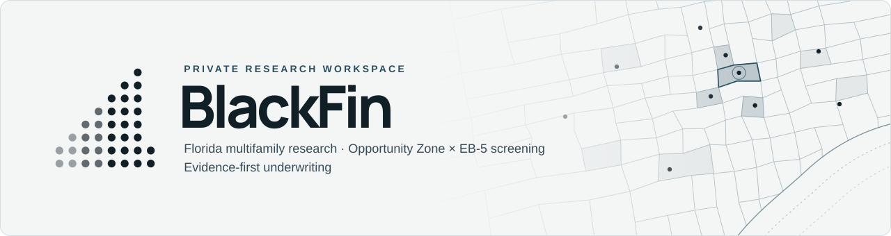
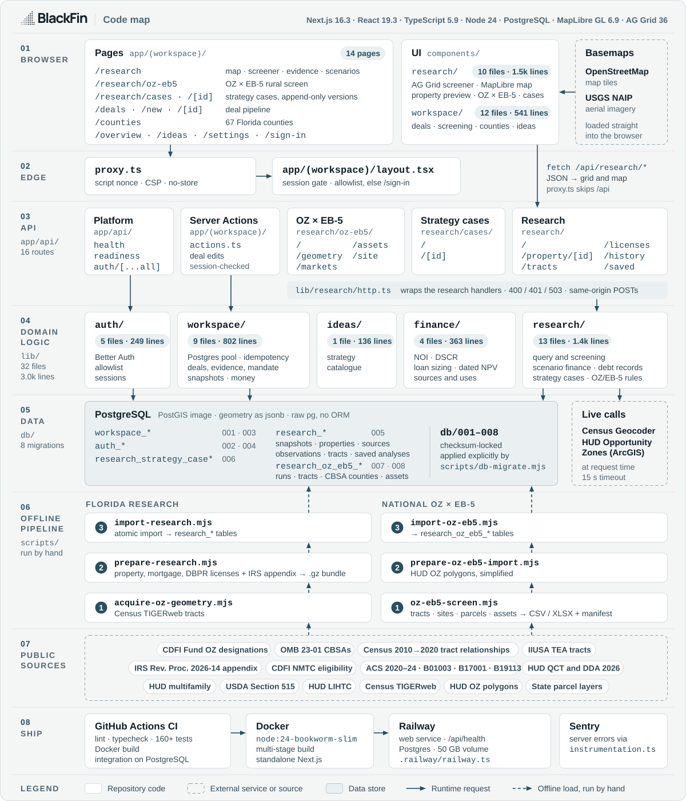
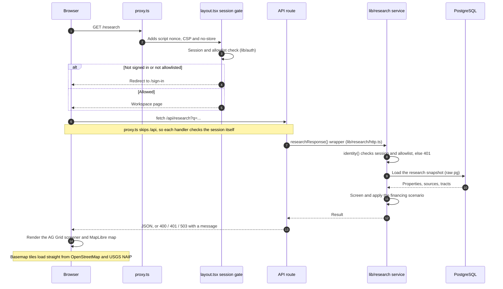
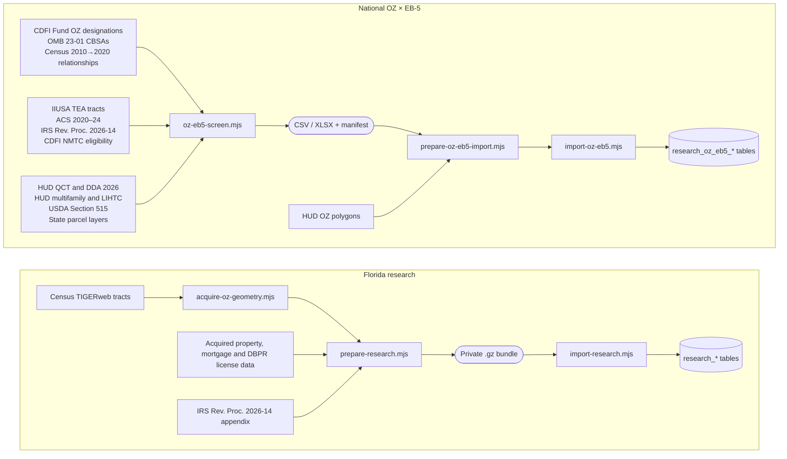

<p align="center">
  <picture>
    <source media="(prefers-color-scheme: dark)" srcset="docs/assets/blackfin-banner-dark.svg">
    
  </picture>
</p>

<p align="center">
  <a href="https://github.com/npstewart87/BlackFin/actions/workflows/ci.yml"></a>
  
  
  
  
  
  
  
</p>

BlackFin is a private research workspace for Florida multifamily investment, used by a small allowlisted group. It links a property map, a dense financial screener and an evidence inspector to Opportunity Zone eligibility, recorded mortgages and transparent financing scenarios, and extends to a national Opportunity Zone × EB-5 rural screen. It is built evidence-first: every value keeps its source, vintage and date, missing data stays visible, and no result is reduced to a black-box score.

## What it does

<table>
  <tr>
    <td width="50%" valign="top"><b>Linked map, screener and evidence inspector</b><br>One <code>/research</code> view: click the map to filter the screener, then open the evidence behind any row.</td>
    <td width="50%" valign="top"><b>2027 OZ nomination-eligible tract overlay</b><br>Tracts from the IRS Rev. Proc. 2026-14 appendix, labelled eligible for nomination, never as designated.</td>
  </tr>
  <tr>
    <td valign="top"><b>Lender and maturity comparisons</b><br>Compare lenders and maturities across recorded mortgages; recorded amounts are not treated as current balances.</td>
    <td valign="top"><b>Financing-threshold scenarios</b><br>Every input stays visible and editable, so results are thresholds you can audit, not black-box scores.</td>
  </tr>
  <tr>
    <td valign="top"><b>Evidence-linked strategy cases</b><br>Open a case from a property and a recorded instrument; every revision is a new, append-only version.</td>
    <td valign="top"><b>National OZ × EB-5 rural screen</b><br>Classifies designated OZ tracts against the EB-5 rural test and tests a single site live via the Census Geocoder.</td>
  </tr>
  <tr>
    <td valign="top"><b>Deal pipeline with dated evidence</b><br>Manual deals carry dated evidence, and every decision is saved as an immutable snapshot.</td>
    <td valign="top"><b>Receipts on every source</b><br>Each imported source records a SHA-256 hash and a vintage, so any figure traces back to its file.</td>
  </tr>
</table>

## Code map

<picture>
  <source media="(prefers-color-scheme: dark)" srcset="docs/assets/code-map-dark.svg">
  
</picture>

<sub>Every box is a real path in this repository, with file and line counts from the current tree. Solid arrows are runtime requests; dashed arrows are offline loads run by hand.</sub>

## How a request flows

A page load passes through the proxy and the session gate; the grid and map then fetch JSON from route handlers that check the session again, because the proxy skips `/api`.



## Data pipeline

Research data arrives through scripts run by hand. At request time the app reads the imported snapshot, and its only outbound calls are single-site OZ × EB-5 checks.



## Repository at a glance

| Folder | Purpose | Size |
| --- | --- | --- |
| [`app/`](app) | Next.js App Router: workspace pages, sign-in and 16 API route handlers | 42 TS/TSX files |
| [`components/`](components) | Research workspace, map, screener, strategy cases and deal pipeline UI | 24 files |
| [`lib/`](lib) | Domain logic: auth, finance, research, workspace and ideas | 32 files, about 3.0k lines |
| [`db/`](db) | Checksum-locked SQL migrations, applied explicitly | 8 migrations |
| [`scripts/`](scripts) | Migrations, backups, acquisition, preparation, imports and smoke checks | 20 scripts |
| [`tests/`](tests) | `node:test` suites for finance, auth, workspace, research and integration | 17 files, 160+ tests |

## Quick start

Requires Node.js 24 and PostgreSQL 16 or newer. Create a private `.env.local` from [`.env.example`](.env.example) first; the full steps and sign-in options are under [Run locally](#run-locally).

```sh
npm ci
node --env-file=.env.local scripts/db-migrate.mjs   # or npm run db:migrate with the variables exported
npm run dev                                         # http://127.0.0.1:3000/research
npm run check                                       # lint, types, tests, build and smoke checks
```

## Project details

Current expansion: national Opportunity Zone / EB-5 rural discovery. [OZ-EB5-SCREEN.md](docs/OZ-EB5-SCREEN.md) describes the offline screen that classifies every designated Opportunity Zone tract against the EB-5 rural test from official public sources and tests individual sites through the Census Geocoder. National OZ × EB-5 is in the application at `/research/oz-eb5`: the 2018 zones screened against the EB-5 rural test, and the 2027 round on Treasury's revised eligible list (25,461 tracts) with each state's list status, compared tract by tract with the 2018 zones. The acquired property coverage described below remains the Florida baseline.

Private Florida multifamily research and investment analytics for one shared, allowlisted workspace. Start at `/research`: a linked property map, dense financial screener and evidence inspector connect acquired data to Opportunity Zone nomination eligibility, lender/maturity comparisons and saved financing-threshold scenarios.

See the [current handoff](docs/HANDOFF.md), [workspace directory map](docs/WORKSPACE.md), [release contract](docs/RESEARCH-RELEASE.md) and [roadmap](docs/ROADMAP.md). Manual deals and Ideas remain supporting workflows.

The [September 14 economic opportunity research](docs/research/2026-09-14-economic-opportunity-thesis.md) records the evidence, counterevidence and open questions behind new revenue opportunities. [Strategy execution requirements](docs/STRATEGY-EXECUTION.md) connect that research to proposed property-to-case workflows; these requirements are not a claim of implemented underwriting.

The first pass of the evidence-linked research-to-case workflow is implemented on the continuation branch: a property record and, where selected, one recorded instrument open a strategy case with a fixed origin and append-only versions (state, payer, role, evidence status, proposed economics, missing inputs, alternatives, disposition and next action) at `/research/cases`. The [canonical handoff](docs/HANDOFF.md) records what was verified, its limits, checkout state and next steps; the [release contract](docs/RESEARCH-RELEASE.md#strategy-cases) records the case contract. Historical rebuild and review notes do not impose a new planning stop.

### Run locally

Use Node.js 24 and PostgreSQL 16 or newer. The original checkout and `.local/blackfin-build` worktree now share the released source; use the latter for its existing local development configuration. See the [workspace map](docs/WORKSPACE.md) for private data and archive locations.

1. Run `npm ci` to install the locked dependencies.
2. Create a private `.env.local` using [.env.example](.env.example) as the template. Set `DATABASE_URL` to the intended local database, `DATABASE_SSL_MODE=disable` only for loopback, `BETTER_AUTH_URL=http://127.0.0.1:3000`, and a generated `BETTER_AUTH_SECRET` of at least 32 characters. Configure one supported sign-in method; email uses `ALLOWED_EMAILS` for one or two approved addresses. See [sign-in configuration](docs/DEPLOYMENT.md#sign-in-configuration).
3. Confirm the database target, then explicitly apply migrations:
   ```sh
   node --env-file=.env.local scripts/db-migrate.mjs
   ```
   Standalone Node scripts need the explicit environment-file option (or already exported environment variables). Web startup does not apply migrations.
4. Run `npm run dev` and open [http://127.0.0.1:3000/research](http://127.0.0.1:3000/research). Next.js loads `.env.local`. Initial email password creation requires `ACCOUNT_SETUP_OPEN=true`; close it after the intended accounts are created.

A new database has no acquired research snapshot. Private source import is a separate operator action; use the retained acquisition and [release contract](docs/RESEARCH-RELEASE.md), without rerunning paid collection or copying exports into public assets.

On Windows PowerShell, use `npm.cmd` if execution policy blocks `npm.ps1`.

### Verify changes

Run `npm run check` for lint, types, financial references/errors/invariants, financial fault injection, auth/workspace/research tests (including strategy-case validation and state gates), production build and unauthenticated HTTP smoke checks. Database integration requires the separately configured isolated loopback database procedures in [db/README.md](db/README.md): `node scripts/db-test.mjs` for the manual workspace and `node scripts/research-db-test.mjs` for imports and strategy cases. A passing unit suite does not establish database or live browser behavior.

Before financial changes, read [calculation validation](docs/CALCULATION-VALIDATION.md). Migrations remain explicit and checksum-locked; preserve applied files and add forward migrations. Deployment uses the root Dockerfile and `.railway/railway.ts`; verify Git, remote revision, CI and actual Railway status separately.

### Coverage and limits

The September 13 baseline records 1,262 regional provider properties, 3,177 apartment licenses, 239 nomination-eligible tracts and 424 provider points inside those tracts. Acquired counties: Hillsborough, Pinellas, Manatee, Sarasota, Charlotte, Lee and Collier. Eventual scope: all 67 Florida counties.

Current NOI, rent rolls, actual occupancy, payoff and capex remain unknown. Provider properties, communities, parcels and financing facilities are different entities. Recorded amounts are not current obligations; eligible tracts are not confirmed designations or approved tax benefits. The app supports transparent financing thresholds, not full underwriting, actual refinance gaps, calibrated grades or distress probabilities.

The September 14 release through PR #7, commit `38e83f6`, includes mobile polish, contextual help, the dot-matrix identity, grey footer and checkout reconciliation. The September 15 release through PR #8, main `5bf6e2f`, adds the strategy-case workflow after migration 006 was applied explicitly, and PR #10, main `be917d5`, adds map click-to-filter, property previews and the reorganized Ideas page; see the [handoff](docs/HANDOFF.md) for the receipts. Delivery receipts are historical; dated release checks do not establish future service health.

Private personal repository: [npstewart87/BlackFin](https://github.com/npstewart87/BlackFin). No public signup, billing or multitenant organizations. Credentials, provider files, database archives and private browser captures stay out of Git and public assets.
